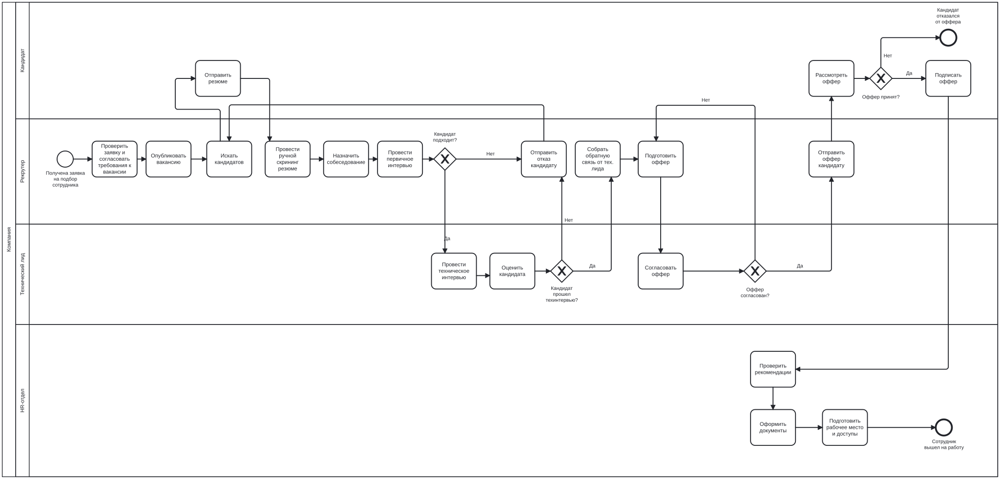
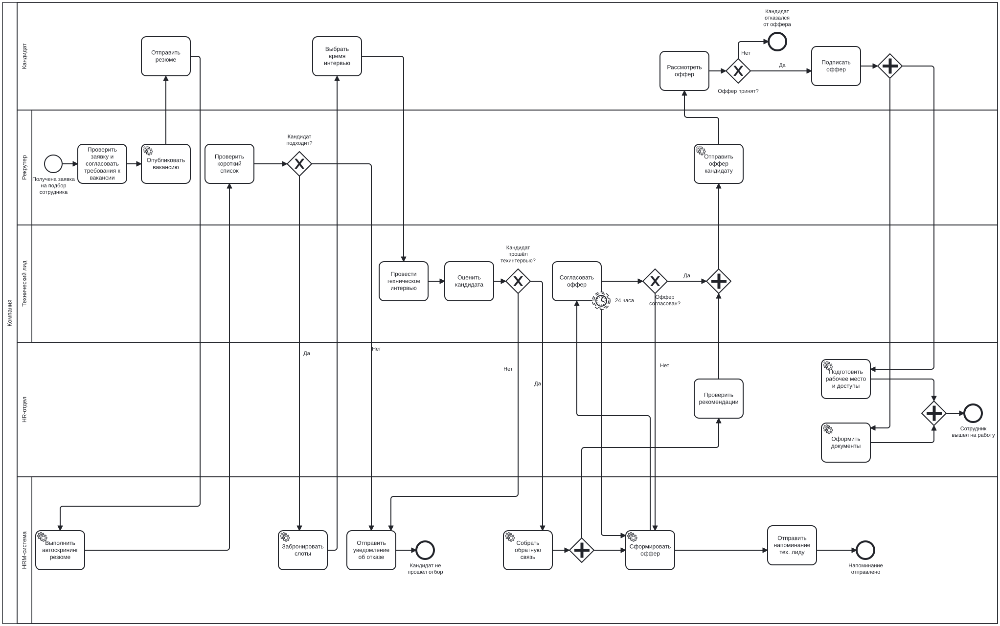

# Процесс найма нового сотрудника: As Is и To Be

## 1. Описание процесса

Процесс начинается с заявки на подбор сотрудника, поступившей рекрутеру, и заканчивается выходом сотрудника на работу.

Участники (дорожки пула «Компания»): Кандидат, Рекрутер, Технический лид, HR-отдел. В «To Be» добавлена дорожка «HRM-система».

## 2. Диаграмма «As Is»

Файл для редактирования: [as-is.bpmn](as-is.bpmn).

**Ход процесса:**

1. Рекрутер проверяет заявку, согласует требования, публикует вакансию и ищет кандидатов.
2. Кандидат отправляет резюме. Рекрутер вручную скринит резюме, назначает собеседование и проводит первичное интервью.
3. Если кандидат не подходит, рекрутер отправляет отказ и продолжает поиск.
4. Если подходит, технический лид проводит техническое интервью и оценивает кандидата. При отрицательной оценке кандидату отправляется отказ.
5. Рекрутер собирает обратную связь, готовит оффер, тех. лид согласует его. При несогласовании оффер дорабатывается.
6. Рекрутер отправляет оффер, кандидат его рассматривает. При отказе процесс завершается, при согласии кандидат подписывает оффер.
7. HR-отдел проверяет рекомендации, оформляет документы, готовит рабочее место и доступы. Сотрудник выходит на работу.

## 3. Узкие места «As Is»

| № | Узкое место | Чем мешает |
|---|---|---|
| 1 | Ручная публикация вакансии | рекрутер тратит время на рутину |
| 2 | Ручной скрининг резюме | самая трудоёмкая часть работы рекрутера |
| 3 | Согласование собеседований перепиской | паузы между шагами, потеря времени |
| 4 | Ручная отправка отказов | кандидаты «висят» без ответа |
| 5 | Рекрутер собирает обратную связь у тех. лида | ожидание, напоминания вручную |
| 6 | Оффер собирается вручную | дублирование данных, ошибки |
| 7 | Долгое согласование оффера без сроков | оффер «зависает», кандидат уходит к конкуренту |
| 8 | Проверка рекомендаций после подписания оффера | простой, шаги идут строго друг за другом |
| 9 | Последовательное оформление документов и подготовка рабочего места | увеличивает срок выхода на работу |

## 4. Диаграмма «To Be» (внедрение HRM-системы)

Файл для редактирования: [to-be.bpmn](to-be.bpmn).

### Решения

| Узкое место | Решение в «To Be» | Элемент на схеме |
|---|---|---|
| Ручная публикация вакансии | автопубликация на job-сайтах из HRM | Service Task «Опубликовать вакансию» |
| Ручной скрининг | автоскрининг, рекрутер проверяет только короткий список | Service Task «Выполнить автоскрининг резюме» и «Проверить короткий список» |
| Согласование собеседований | кандидат выбирает время, HRM бронирует слот | Service Task «Забронировать слоты» |
| Ручные отказы | автоматическое уведомление по шаблону | Service Task «Отправить уведомление об отказе» |
| Сбор обратной связи | оценка собирается в HRM автоматически | Service Task «Собрать обратную связь» |
| Ручной оффер | формирование по шаблону из карточки кандидата | Service Task «Сформировать оффер» |
| Долгое согласование оффера | таймер 24 часа и автоматическое напоминание | граничное событие-таймер и Service Task «Отправить напоминание тех. лиду» |
| Отправка оффера | автоматическая отправка из HRM | Service Task «Отправить оффер кандидату» |
| Рекомендации после оффера | проверка идёт параллельно с формированием и согласованием оффера | Parallel Gateway |
| Документы и рабочее место подряд | выполняются одновременно, автозаполнение и автоматическая заявка на доступы | Service Task и Parallel Gateway |

## 5. Сравнение «As Is» и «To Be»

Значения оценочные. При наличии реальных данных компании замените их на фактические.

| Показатель | As Is | To Be |
|---|---|---|
| Ручные операции рекрутера | публикация, скрининг, слоты, отказы, оффер, документы | остаётся проверка короткого списка |
| Согласование оффера | без регламента сроков | напоминание через 24 часа |
| Проверка рекомендаций | после подписания оффера | параллельно с оффером |
| Документы и рабочее место | последовательно | параллельно |
| Хранение данных | почта, таблицы | единая карточка кандидата в HRM |
| Общий срок найма | дольше | короче за счёт автоматизации и параллельных веток |

## 6. Выводы

В «As Is» процесс найма выполняется в основном вручную и содержит ожидания на стыках между рекрутером, техническим лидом и HR-отделом. Главные узкие места: ручной скрининг, согласование собеседований перепиской и долгое согласование оффера.

В «To Be» с HRM-системой десять шагов автоматизированы (Service Task), для согласования оффера добавлен таймер с автоматическим напоминанием, а проверка рекомендаций, оформление документов и подготовка рабочего места идут параллельно. В результате сокращаются ручной труд и простои, а срок закрытия вакансии уменьшается.

В диаграммах использованы пул и дорожки, начальные, промежуточные (таймер) и конечные события, задачи и Service Task, а также исключающие (Exclusive) и параллельные (Parallel) шлюзы. Включающий шлюз (Inclusive) не потребовался: в процессе нет ситуаций, где по условию выбирается несколько веток сразу.